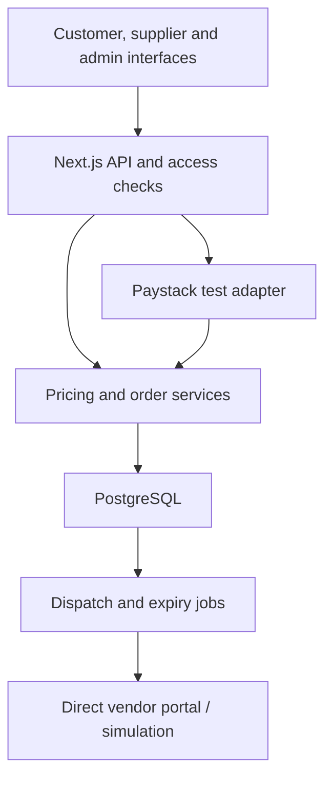

# AHIAKOM technical architecture

Development baseline: 12 November 2026. Proposed production architecture requires business sign-off and production validation.

## 1. Design assessment

The reviewed `ahiakom_prototype.html` provides an emerald/gold homepage, seven simplified category choices, eight sample products, text search and an in-memory cart. Account and checkout buttons open informational placeholders. Cart data disappears on reload; there is no database, authentication, payment verification, supplier portal or server-side pricing. The desktop/mobile PNG is a visual concept with attractive category organization. Its reviews, discounts, free-shipping promise, verified-seller claims and 24/7 support are not operational evidence.

This build retains the colour direction, premium hierarchy, category browsing, hero and mobile shopping pattern. It replaces emoji products with small original illustrations, labels the catalogue as demonstration data and connects the interfaces to a persistent backend. Real product photography, live supplier contracts and final customer policies remain requirements.

## 2. Selected architecture

A modular monolith minimizes deployment and operational complexity. Next.js App Router renders the React interface and hosts TypeScript HTTP handlers in one Node.js service. A single PostgreSQL database holds transactional records. A separate scheduled process executes maintenance against that same database when deployed; direct and simulated connectors run synchronously in small claimed batches for this development release.

| Layer                 | Implemented choice                                                   | Production direction                                                                       |
| --------------------- | -------------------------------------------------------------------- | ------------------------------------------------------------------------------------------ |
| UI                    | React + TypeScript; responsive component CSS                         | Preserve design tokens; consider Tailwind when team conventions justify migration          |
| Framework             | Next.js App Router, Node runtime                                     | Container or managed Node hosting                                                          |
| Database              | PGlite disk-backed PostgreSQL engine locally; `pg` adapter available | Managed PostgreSQL with TLS, backups and monitored connections                             |
| Data access           | Parameterized SQL through a small `DB` interface                     | Keep explicit transactional SQL; adopt an ORM/query builder only with migration discipline |
| Authentication        | scrypt password hashes; hashed opaque sessions                       | Email verification, recovery, MFA for privileged accounts and session administration       |
| Media                 | Local original SVG illustrations                                     | Private upload staging plus approved object storage/CDN                                    |
| Payments              | Simulation plus Paystack test-only initialization/verification       | Merchant approval, live staging validation, refunds and settlement reconciliation          |
| Supplier integrations | Direct vendor portal and simulated connector                         | Explicitly authorized provider adapters                                                    |
| Notifications         | In-portal order/support state and dispatch records                   | Transactional email/SMS with retries and delivery monitoring                               |

PGlite is not a production multi-process database. Its role is reproducible, persistent local development using PostgreSQL semantics. The remote PostgreSQL adapter is implemented but has not been integration-tested against a provisioned PostgreSQL server in this environment.

## 3. Entity model

| Table           | Purpose and principal constraints                                                                  |
| --------------- | -------------------------------------------------------------------------------------------------- |
| users           | Unique email; customer, supplier, support or admin role                                            |
| sessions        | SHA-256 hash of random token; expiry; user reference                                               |
| suppliers       | One profile per supplier user; approval state, commission and connector                            |
| categories      | Managed names and stable identifiers                                                               |
| pricing_rules   | Global/category markup, fixed amount, discount, profit floor and cost allowances                   |
| products        | Each row is a sellable SKU; supplier cost, available stock, category, optional variant group/label |
| cart, wishlist  | User-scoped unique product entries                                                                 |
| orders          | Customer-visible order, address, totals, state, idempotency key and request hash                   |
| order_items     | Immutable product name, unit cost, selling price, supplier entitlement and quantity snapshots      |
| fulfilments     | One per order/supplier; status and tracking reference                                              |
| payments        | One reference per order; provider, amount, status, verified fees and provider ID                   |
| refunds         | Requested amount/reason and processing state                                                       |
| return_requests | One whole-order request; approval/receipt/rejection and inspection note                            |
| settlements     | One simulated settlement per fulfilment; unique reference                                          |
| order_costs     | Reviewed delivery, tax and other costs for contribution reporting                                  |
| outbox          | One dispatch job per fulfilment; attempts, retry time and error                                    |
| support_tickets | User-scoped request, staff reply and state                                                         |
| audit           | Actor, action, entity and timestamp                                                                |
| rate_limits     | Database-backed attempt counters with expiration                                                   |

Variants are independently priced and stocked product rows sharing a supplier-scoped `group_key`. Product detail offers sibling SKU selection. This is a simple MVP grouping model; structured size/colour matrices, attribute definitions and parent-level galleries are future work.

## 4. Money and pricing

All stored money is integer **kobo**; percentage values use integer basis points. The UI displays naira. Supplier cost never comes from the browser and is removed from the public catalogue response.

1. Select the category rule, otherwise the global rule.
2. Compute base retail = supplier cost × (1 + markup) + fixed markup, rounding upward to an integer kobo.
3. Apply promotional reduction. Supplier entitlement = cost less the supplier-specific commission.
4. Estimate processing fee using the configured local Paystack fee model in code; subtract configured shipping subsidy, estimated tax burden and other unit costs.
5. Disable purchasing when estimated contribution falls below the rule's floor.
6. Re-evaluate server-side at order creation and snapshot all amounts.

The fee estimator is a planning approximation for Nigerian local transactions. It is not suitable for every card origin, account, channel or future pricing change. Finance uses verified provider fees and separately reviewed costs. Zero tax defaults are exclusively for demonstration. A tax adviser must decide the correct accounting treatment for direct vendor, principal/reseller, commission and cross-border models.

Customers see a flat **demo** shipping estimate of ₦2,500 per supplier. It is not a courier quote. Actual shipping and tax integration must replace it before any real order.

## 5. Transaction boundaries and concurrency

Checkout locks the customer record to serialize duplicate submissions, validates the idempotency key against a request hash, and atomically decrements stock using `UPDATE ... WHERE stock >= quantity`. Product updates follow deterministic ID order. A transaction creates the order, item snapshots, supplier fulfilments and payment record together. Failure rolls everything back.

Payment confirmation locks the stored payment and parent order, compares reference/provider/currency/amount, and uses a unique provider transaction ID. A replay returns without new dispatch. A successful payment updates order/fulfilment state and inserts one outbox job per supplier in the same transaction. A late payment for a closed order is retained as an exception requiring refund review, rather than silently re-opening fulfilment.

Cancellation only applies to unpaid orders and restores reserved units once. Maintenance releases unpaid reservations older than 30 minutes. A deployed scheduler is required; merely creating the command does not schedule it. Late provider confirmations require explicit reconciliation and refund handling.

Direct vendor order visibility is immediate after successful payment. The dispatch worker marks direct portal delivery or simulated acceptance, retries unavailable adapters after five minutes, and parks persistent failures after five attempts. No external supplier API is called. Real connectors should perform network I/O outside a long-running database transaction using durable leases and supplier idempotency keys; the current transaction-held worker is appropriate only for its local adapters.

## 6. States and permissions

| Actor         | Allowed actions                                                                                                      |
| ------------- | -------------------------------------------------------------------------------------------------------------------- |
| Anonymous     | Browse catalogue; guest cart/wishlist in local browser storage                                                       |
| Customer      | Own account, own cart/wishlist/orders, unpaid cancellation, refund/return requests, own support tickets              |
| Supplier      | Own business profile, approved SKU inventory, only assigned seller fulfilments and entitlement reports               |
| Support       | Read operational dashboard and reply to support tickets; cannot approve suppliers, set pricing or settle             |
| Administrator | Approvals, category/pricing changes, refunds/returns, operations, cost review, simulated settlement and audit review |

The HTTP handler enforces role and ownership; hiding UI controls is not an authorization mechanism. Supplier fulfilment responses contain only that supplier's items and the delivery address needed for that order. Public registration cannot choose or escalate its role. The admin bootstrap is a local operations command, not an HTTP endpoint.

Implemented order progression: pending_payment → awaiting_supplier → processing → shipped → delivered. Confirmed payment is separately recorded as `payments.status=success`; there is no persisted transient `paid` order state. Failure, unpaid cancellation, returned, partially_refunded and refunded states are also represented. One seller failure sets the parent to failed for exception review; other seller records remain separately visible.

Returns require approval and receipt review. They do not automatically restock potentially damaged goods. A refund is a separate controlled operation. Simulated settlement requires delivery, successful simulated payment and no refund/return hold. Any recovery from a supplier after an earlier settlement remains an operations task; no automatic bank debit is implied.

## 7. Security controls and limits

Implemented: scrypt with per-password random salt, constant-time hash comparison, 256-bit random session tokens stored hashed, HttpOnly/SameSite cookies, Secure cookies on HTTPS origins, exact Origin checks on writes, Zod validation, parameterized SQL, role/ownership checks, payment signature verification, provider amount reconciliation, idempotency, transaction guards, authentication/checkout/support rate limits and audit events.

The modern Paystack signature validates raw bytes and timestamp freshness; legacy verification is accepted only when no modern signing secret is configured. The webhook performs verification before returning success; failed verification can therefore be retried by the provider. A production durable webhook inbox and asynchronous processing worker are still required.

Production gaps: MFA, email verification/recovery, credential-stuffing/IP controls at the trusted edge, hard request-body limits before buffering, detailed Content Security Policy, complete session revocation UX, privileged action confirmation, automated dependency scanning, production penetration/load testing, monitoring, anti-fraud and retention/deletion workflows. The SQL adapter exposes internal row types broadly; typed repository models should replace remaining `any` fields during hardening.

## 8. Scaling sequence

Start with a Node service, managed PostgreSQL, object storage and one worker/scheduler. Add indexes and server-side catalogue filtering under load; the current UI loads paginated catalogue pages into memory for interactive sample browsing. Introduce search infrastructure only when measured catalogue size/traffic requires it. Split fulfilment or payments into separate services only when reliability or team boundaries warrant the operational cost.

For production, replace the single cumulative development SQL file with versioned migrations, a migration lock and CI-tested upgrades. Add distributed worker leases, observability, provider circuit breakers, dead-letter tooling and reconciliation jobs before scaling order volume.
